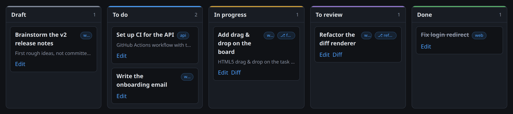

# Tikedenn



A shared kanban board where **AI agents** (Claude Code, pi) pick up the work
and **humans approve** the key steps (review, then automatic deployment).

```
draft ──human──▶ todo ──agent──▶ progress ──agent──▶ review ──human──▶ deploy ──worker──▶ done
                  ▲                                    │
                  └───── human: "request changes" ─────┘
```

- **draft**: task being written (human). **todo**: ready for an agent.
- **progress**: claimed by an agent (renewable lease, 60 min by default); an
  abandoned task (expired lease) can be taken over.
- **review**: the agent pushed its branch and attached a report; the human
  reads the diff and **approves** (→ deploy) or **requests changes** (→ todo,
  the feedback goes to the task log, which the next agent reads).
- **deploy**: the worker merges the branch into the base branch, pushes, then
  runs `publish <name>`; success → **done**, failure → back to review with the
  log. On a **merge conflict**, the project's agent is first asked to rebase
  the branch onto the base (conflict resolution, tests, push
  `--force-with-lease`); the task then goes back to review with its report, so
  that the resolution is read before approving again.

An agent can neither move a task from draft to todo nor approve a review:
these transitions are reserved for humans (enforced by the server).

## Repository layout

| Folder    | Role |
|-----------|------|
| `site/`   | Rust web app (**axum** + **htmx** + askama + SQLite): board, review, API, MCP |
| `cli/`    | Agents' **`tkd`** CLI and **worker** (runs the agents, deploys) |
| `common/` | API types and rules shared by the server and the CLI |
| `agents/` | `tikedenn` skill (Claude Code, pi) and a snippet to copy into an `AGENTS.md` |

## Web app (`site/`)

- **Registered users only** (signed session cookie, Argon2). Public pages: the
  presentation (`/`), `/login`, `/logout`, and `/register` unless
  `REGISTRATION=0`.
- **Administration**: on first start, an `admin` account is created with a
  random password printed on the console; `/admin/users` resets passwords and
  deletes accounts.
- **Board shared** by all users, filterable by project and refreshed
  automatically (htmx): priority, dependencies ("blocked by #12"), agent
  holding the task, branch. Drag and drop between columns. The *Draft* and
  *To do* columns follow the agents' **processing order** (ready tasks first,
  then tasks waiting for their dependencies, placed after them; rank and
  "next" badge in *To do*); a task **inherits the priority** of the tasks
  waiting for it ("urgent ↑ #42"). Hovering a card highlights its
  dependencies and the tasks waiting for it. On mobile, a single column is
  shown, picked from a drop-down list (*To review* by default).
- **Task**: description and **acceptance criteria** in Markdown (mermaid
  diagrams, Preview / Edit tabs), priority, dependencies, git branch,
  attachments (SQLite BLOB, 10 MB max) and **log** (comments, agent reports,
  reviews, state changes, deployment logs).
- **Review**: on the task page and on the **diff** page (branch vs base since
  the fork point, cached clone per project, with syntax highlighting),
  *Approve* / *Request changes* panel. "To review" badge in the navigation.
- **Shared projects**: git repository (+ personal token for a private https
  repository), base branch (main/master by default), `publish` name and
  **agent**: the worker's default, Claude Code, pi, or *None* — a project
  reserved for humans (to-do list…), whose tasks no agent can take or move.
- **Agents page** (`/settings/tokens`): API tokens per agent (read-only or
  read/write scope; only the SHA-256 is stored, the token is shown once) and
  setup instructions.
- **Notifications** via ntfy (optional): task to review, deployment failed or
  done — variables `NTFY_URL`, `NTFY_TOKEN`, `PUBLIC_URL`.

### Agents API

`Authorization: Bearer tkd_…` (token created on the Agents page).

| Method | Route | Role |
|--------|-------|------|
| GET  | `/api/v1/me` | token identity |
| GET  | `/api/v1/projects[?repo=URL]` | projects (or the one whose repository matches) |
| GET  | `/api/v1/tasks[?status=&project=]` | list |
| POST | `/api/v1/tasks` | propose a task (created in draft) |
| GET  | `/api/v1/tasks/{id}` | full task with its log |
| PATCH| `/api/v1/tasks/{id}` | update the given fields: `title`, `description`, `acceptance`, `project`, `priority`, `branch`, `depends_on` |
| POST | `/api/v1/tasks/claim-next` | `{"projects": [], "status": "todo"\|"deploy"}` → claimed task, or 204 |
| POST | `/api/v1/tasks/{id}/claim` | claim / renew the lease (`"status"`: only if the task is still in that state) |
| POST | `/api/v1/tasks/{id}/release` | give the task back |
| POST | `/api/v1/tasks/{id}/move` | `{"status", "note"}` |
| POST | `/api/v1/tasks/{id}/comments` | `{"body", "kind"}` |
| PUT  | `/api/v1/tasks/{id}/files/{name}` | attach a file (raw body) |
| GET  | `/api/v1/files/{id}` | download an attachment |

**MCP**: the same operations on `POST /mcp` (streamable HTTP transport,
stateless), for Claude Code:

```sh
claude mcp add --transport http tikedenn https://tikedenn.smallbard.com/mcp \
    --header "Authorization: Bearer tkd_…"
```

## `tkd` CLI and worker (`cli/`)

```sh
cargo install --path cli                         # installs tkd
tkd login --url https://tikedenn.smallbard.com --token tkd_…
tkd install-skill                                # tikedenn skill for Claude Code and pi
```

Agent commands: `tkd next`, `tkd show <id>`, `tkd claim <id>`,
`tkd comment <id> -m …`, `tkd submit <id> -m <report>` (pushes the branch if
needed, then moves to review), `tkd release`, `tkd create`, `tkd update`,
`tkd attach`, `tkd list`… (`--json` everywhere, `tkd --help`). Inside a
repository, `tkd next` and `tkd list` are limited to the project whose
`origin` remote matches.

**Worker**: `tkd worker [--agent claude|pi] [--max-parallel N] [--project P] [--no-deploy|--deploy-only] [--once]`

1. Finds the projects' local clones: explicit path (`[projects]` in the
   config), otherwise the folder under `repos_root` (default `~/Repos`) whose
   `origin` matches the project's repository. Projects whose agent is *None*
   are skipped.
2. Takes the `todo` tasks of these projects (effective priority — inherited
   from the tasks waiting for them — then age, skipping blocked tasks),
   creates a **git worktree per task** on its branch (`task/<id>-<slug>`),
   runs the project's agent (otherwise the one from `--agent` / the config)
   with the task and the protocol, and renews the lease while it works.
3. If the agent stops without submitting: its commits are pushed to the
   task's branch and the task moves to review with the end of its output.
   **Worker stopped while an agent was working** (Ctrl-C, restart…): on the
   next start, then on every round, the worker first resumes its interrupted
   tasks — in progress, claimed with its token, whose worktree exists on the
   machine and that no live worker is handling (marker
   `~/.cache/tikedenn/running/task-<id>` holding the pid). The agent restarts
   in the same worktree, warned that some work may already be there.
   **Usage limit** ("You've hit your session limit", rejected
   `rate_limit_event`) or an agent that stops within 2 min without producing
   anything: the task goes back to **todo** (not review: there is nothing to
   read), the worktree is kept (the next agent is told about the uncommitted
   changes) and the worker pauses the agents until the limit resets
   (otherwise 15 min) instead of draining the queue; deployments go on.
4. Deploys approved tasks: `--no-ff` merge in a detached worktree, push of
   the base, `publish <name> --repo <folder>` (the user's clone if it is
   clean and on the base, otherwise the worktree), publish log attached to
   the task. Merge conflict: the rebase is handed to the agent (task
   worktree, reset to the approved branch), checked by the worker (the pushed
   branch must contain the base; it pushes a local unpushed rebase itself),
   then back to review with the report or the failure.

Configuration: `~/.config/tikedenn/config.toml` (see the header of
`cli/src/config.rs`) — agent commands (`claude_command`, `pi_command`, with
`{prompt}`), `max_parallel`, `agent_timeout_minutes`, `work_dir` (worktrees
and logs, default `~/.cache/tikedenn`), `publish_command`. By default Claude
Code runs with `--dangerously-skip-permissions` (no permission prompts: it
can run tests and builds in its worktree, but also any command with the
user's rights — keep it to a trusted machine). To restrict it:
`claude_command = ["claude", "-p", "{prompt}", "--permission-mode",
"acceptEdits", "--allowedTools", "Bash(git:*),Bash(tkd:*)"]`.

### Worker at startup (systemd user service)

`tkd worker` only runs while it is started. To start it with the machine,
install the provided user service (under your own account, to keep your git /
SSH credentials and your `tkd` configuration):

```sh
tkd login --url https://… --token tkd_…         # first: otherwise the service fails in a loop
cp cli/deploy/tikedenn-worker.service ~/.config/systemd/user/
systemctl --user daemon-reload
systemctl --user enable --now tikedenn-worker
sudo loginctl enable-linger "$USER"             # start at boot, even without an open session
```

- Worker logs: `journalctl --user -u tikedenn-worker -f`; each agent's
  output: `~/.cache/tikedenn/logs/`, live with `tkd logs <id> -f` (`tkd logs`
  lists recent logs, `--deploy` for the deployment one). Claude Code runs
  with `--output-format stream-json` (added automatically when the
  configuration sets no format): each message, tool call and result becomes
  a line timestamped from the start.
- Options (`--agent pi`, `--max-parallel 2`, `--no-deploy`…): on the
  `ExecStart` line, or in `[worker]` of `~/.config/tikedenn/config.toml`.
- The service's `PATH` must contain `tkd`, `claude`, `publish` and, for pi,
  node's `bin` folder (nvm); SSH pushes need a passphrase-less key or an SSH
  agent reachable by the service.
- `systemctl --user stop tikedenn-worker` also kills running agents: their
  tasks become available again when the lease expires (30 min).
- With `--dangerously-skip-permissions` (the default), these are agents
  without guardrails running permanently: keep them to a trusted machine.

## Development

```sh
cd site && cargo run   # http://127.0.0.1:3003 (database site/app.sqlite, auto-migrated)
cargo test --workspace # unit tests (migrations, workflow, validation…)
```

## License

MIT — see [LICENSE](LICENSE). Bundled third-party software (htmx, mermaid):
[THIRD_PARTY.md](THIRD_PARTY.md).
